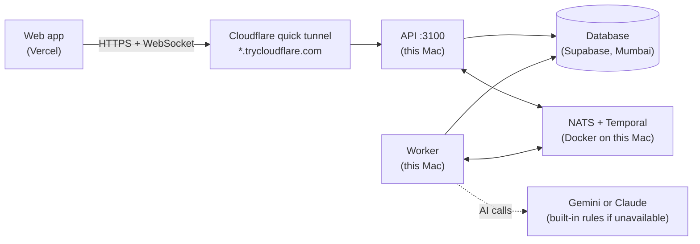

# Demo guide

How to put ONEHUMAN OS online for a demo, and what to show once it's up.

## How the demo is put together



- **Vercel** serves the web app.
- **Supabase** holds the database.
- **This Mac** runs everything that must stay running: the API, the worker, Temporal and NATS. Vercel and Supabase can't host those, because they run only short-lived functions.
- **A Cloudflare quick tunnel** gives the API a public HTTPS address without opening ports.
- The demo runs **beside** `pnpm dev`, with its own port (3100) and its own workflow queue, so your usual setup keeps working.
- **The demo is online only while `pnpm demo` runs on this Mac.**

## One-time setup

1. **Supabase.** At [supabase.com](https://supabase.com), create a new project in region **South Asia (Mumbai)** and set a database password. When it's ready:
   - Click **Connect** → **Session pooler** and copy the URI.
   - Replace `[YOUR-PASSWORD]` in it with your password.
   - Create `master-ai-backend/.env.demo` with one line:
     ```
     DATABASE_URL=postgresql://postgres.<project-ref>:<password>@aws-…-ap-south-1.pooler.supabase.com:5432/postgres
     ```
     This file is ignored by git. Never paste it into chats or issues.
2. **Vercel.** Create an account at [vercel.com](https://vercel.com), then run `npx vercel@61.1.0 login`.
3. **Tools.** Run `brew install cloudflared`, then `pnpm infra:up` (Temporal and NATS in Docker).
4. **The database.** Run `pnpm demo:setup`. It:
   - adds the `vector` and `citext` extensions;
   - creates the app's own database role, which can't get around row-level security, with a generated password;
   - runs the migrations;
   - shuts Supabase's built-in API roles (`anon`, `authenticated`) out of the app's tables, since the `users` table holds password hashes.

   It also writes a generated `JWT_SECRET` and the role's password into `.env.demo`.

## Each time you want it up

```bash
pnpm infra:up      # if Docker was restarted
pnpm demo
```

`pnpm demo` does the following, then prints the link:

1. Builds the backend.
2. Opens a tunnel and reads its address.
3. Builds the web app against that address and deploys it to Vercel (project `onehuman-demo`).
4. Starts the API and the worker against Supabase.

**Ctrl-C** stops everything. Each run gets a new tunnel address, so the web app is redeployed each time; the Vercel link stays the same.

## The AI in the demo

The demo uses whatever `master-ai-backend/.env` sets. With a free Gemini key, set:

```
GEMINI_MODEL_FRONTIER=gemini-flash-lite-latest
GEMINI_MODEL_STANDARD=gemini-flash-lite-latest
GEMINI_MODEL_SMALL=gemini-flash-lite-latest
LLM_MAX_RPM=12
```

The demo always turns on `LLM_RULES_WHEN_UNAVAILABLE`. When the key runs out of quota or Google can't be reached, the built-in rules answer instead, so a demo never stalls halfway. A free key allows only a few hundred calls a day, and one case uses dozens. Use made-up data only: on the free tier, Google may use prompts to improve its products.

## What to show (about 10 minutes)

1. **Sign up.** Choose **Set up your organization**, pick *Energy & Heavy Industry* → *Power plant & utilities*, and fill in the account. The preview shows the 8 stages named for a power plant, its kinds of request, who approves, and its agents. Install with sample records.
2. **The team, first.** On **Team**, invite a "Safety officer" with that approver role, then open the invite link in a private window and set a password. Their inbox will show only what they may decide. Then, in **Settings → Phone calls to the team**, either:
   - keep **You do, in this app**, and answer the staff calls that ring at the bottom right; or
   - choose **A simulated staff member**, so the calls answer themselves.
3. **A request.** Click **New request** and paste:
   > Sir, contract lineman Ramesh got shock on 11 kV Kamalpur feeder pole at 3:40 pm. He is conscious, taken to the district hospital.

   Open the case and watch the stages advance on the canvas.
4. **The approval.** It's a P1 accident, so the plant head must approve. Nobody holds that role, so it comes to you, and the card says why. Approve it: your browser signs the decision.
5. **The sign-off.** When the work is done, the sign-off goes to the safety officer. Approve it from their window.
6. **The report.** The case report shows each stage, how long it took, and whether the deadline was met. Copy it as text.
7. **From outside.** In **Settings → Requests**, make a public form link and send a request through it as a customer.
8. **Audit.** The **Audit** page verifies the hash chain and replays every step.

## Troubleshooting

| You see | Do this |
|---|---|
| `No master-ai-backend/.env.demo` | Do step 1 of the one-time setup |
| `Temporal or NATS is not running` | `pnpm infra:up` |
| `Not logged in to Vercel` | `npx vercel@61.1.0 login` |
| `Port 3100 is busy` | A demo is already running; stop it with Ctrl-C first |
| The web app loads but can't sign in | The tunnel address changed (`pnpm demo` was restarted elsewhere). Restart `pnpm demo`; it redeploys |
| Cases run but the AI answers sound generic | The key is out of quota, so the built-in rules are answering. The API log says "the built-in rules answer until …" |
