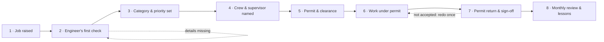

# How ONEHUMAN OS works

This page follows one real request from the moment it arrives to its final report. It is written for anyone. Words in *italics* are explained in the [glossary](glossary.md).

## 1. Setting up: the organization type comes first

An owner signs up and picks a **sector**, then an **organization type**:

| Sector | Ready-made types |
|---|---|
| Energy & Heavy Industry | Power plant & utilities · Manufacturing plant · Construction & infrastructure |
| Trade, Logistics & Tourism | Logistics & transport · Wholesale & retail trade · Travel agency & tour operator |
| Finance & Development | Lender (NBFC, microfinance, co-op bank) · Accounting & tax firm · NGO & development programme |
| Technology & Innovation | Software & SaaS company · IT services & support · Digital agency |
| Essential Public & Service | Hospital & clinic · School, college & coaching · Municipal & citizen services |

Owners whose type isn't listed write it in their own words ("cement grinding unit"). The platform then builds on the closest ready-made type in that sector, or on the sector's defaults.

Each type comes as a *pack*: the 8 stage names in that organization's own words, its kinds of request, who approves and signs off, its AI agents, its records and its daily check-ins. The owner previews all of it and installs it. Nothing is coded per industry; a pack is data ([pack guide](packs.md)).

## 2. A request arrives

Requests come in four ways:

- **New request** in the web or phone app, typed by the owner or a team member.
- **A public form link** the organization shares with its customers.
- **An intake API** that another system or partner posts to, using a key.
- **A daily check-in**: a problem someone reports can become a request in one click.

Each request becomes a *case* with a number in the organization's own style (JOB-0042 at a power plant, LN-0042 at a lender). Words from outside the organization are treated as untrusted: the AI is told never to follow instructions hidden in them.

## 3. Every case runs the same 8 stages

Here is a power plant's version. Every organization has the same 8 steps under its own names.

Take this real message:

> "Sir, contract lineman Ramesh got shock on 11 kV Kamalpur feeder pole at 3:40…"

| # | Generic stage | What happens to this request |
|---|---|---|
| 1 | Request | The case is opened: who sent it, when, and the exact words. |
| 2 | Review | Checks the details are there. If something is missing, the case asks for it and waits. Urgent cases start work while asking. A request the rules say isn't eligible stops here. |
| 3 | Classify | Sets the kind of request (*accident or near miss*), the priority (*P1, critical*), the risk, the department and the deadlines. |
| 4 | Assign | Names the person or team in charge. |
| 5 | Approve | The pack's rules decide whether someone must approve. Here the **plant head** must, because it's a P1 accident. If no approval is needed, this stage is skipped. |
| 6 | Execute | AI agents do the work: they plan it, update records, draft messages, and phone the staff in charge. Every action goes through the same safety checks (section 4). |
| 7 | Close | The work is checked against the request. The **safety officer** signs off. If the result isn't accepted, the work is redone once; a second failure escalates to the owner. |
| 8 | Report | A plain-words report: what was done, how long each stage took, whether the deadline was met, and whether this keeps happening. |

Owners watch this live: the case page shows the 8 stages on an animated canvas, and the phone app shows them as a list with the current stage pulsing.

## 4. Who decides what

The AI does the work, but it never decides what it is allowed to do.

- **Agents propose.** Each step, an agent proposes one action ("update the incident record", "send the follow-up message").
- **A policy engine decides.** Every proposed action gets a risk score: what kind of action it is, how much money is involved, whether it can be undone, whether it reaches outside the company, how sensitive the data is, and the agent's track record. The pack's rules then place it on a scale of **Levels 1 to 5**. Levels 1–3 run on their own, Level 4 waits for a person, and Level 5 is blocked. The rules are written in Cedar, a policy language, not in AI prompts.
- **Named people approve.** An approval goes to the person who holds the role the rule names: the plant head, the credit manager, the insurance desk. If nobody holds that role yet, it goes to the owner and says why. A member without the role is refused.
- **Approvals are signed.** Each phone or browser has its own key, and approving signs the decision with it. The server checks the signature, so the record proves who approved and from which device.
- **Every agent has a job card.** It says what the agent is for, what it never does, which tools it may never use, and the words that make it stop and hand over to a person (anger, legal threats, emergencies, distress, card and OTP secrets, and its industry's own). Owners see the card on the Agents page and can edit it. The stop words are checked by code, not by the AI, and a forbidden tool is a policy the engine refuses.
- **Some work is a job.** A job is a fixed list of steps: read the data, ask the AI to fill a few typed fields, check the result, then act. The checks (does a price match the price list, is the sum right, does the draft promise something it must not) are worked out by code. The AI never chooses a step and never supplies an amount that moves money. A job starts from a new request, a time of day, a list item that falls due, a changed record, or "Run now", and the owner switches each one on and sets how many runs a day it may have. Jobs are not in any pack yet; trial runs come first. See [ADR 0014](adr/0014-job-cards-and-jobs.md).
- **The owner has a kill switch** that pauses all agents and cases at once.

## 5. People who don't use the app

Much of the work is done by staff who never log in. When work needs a person ("make sure the rooms are inspected before Friday"), the agent hands it to the staff member in charge. The platform then phones them: once to assign it, once to follow up, and once to confirm it's done. Calls use real phone lines through Twilio, or a built-in simulator. Unanswered calls are retried, and calls happen only in working hours.

*Routines* are repeating check-ins, such as a daily work report or a stock check. Each one runs either by hand (people fill in a short form) or automatically (the AI phones each person and fills in the answers).

## 6. What people see

People never see tool names, ids or raw data. Every step is told as a sentence ("Recorded the accident involving contract lineman Ramesh"). Every case ends with a report the owner can copy, print or share. The raw detail is kept for auditors on the Audit page, where every change is an append-only, hash-chained event that can be verified.

## 7. With or without an AI key

- **No key:** the platform runs on built-in rules for every stage and agent. This is called *offline mode*. It is deterministic, which is how all the tests run.
- **Claude** (the default) answers when `ANTHROPIC_API_KEY` is set.
- **Google Gemini** is an optional second provider, mainly for testing ([decision 0011](adr/0011-gemini-as-a-second-model-provider.md)). It can be told to fall back to the built-in rules whenever it runs out of quota.

Whatever the provider, the AI's answers are checked against a strict format and merged under the pack's rules. The rules always keep the final say on safety: for example, the AI may raise a case's priority but never lower it below what the rules require.

## 8. Keeping each organization's data apart

Every organization's data lives in the same database, but Postgres row-level security keeps each one's rows invisible to the others. The app connects as a database role that cannot get around those rules.

## Where next

- The words above, defined: [glossary](glossary.md).
- See it running: [demo guide](demo.md).
- How it's built: the [README](../README.md) and [Contributing](../CONTRIBUTING.md).
