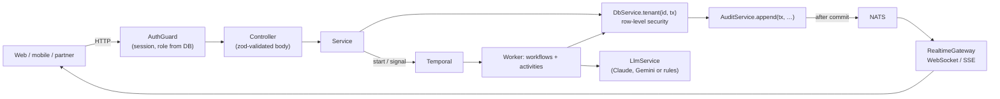

# master-ai-backend

The server side of ONEHUMAN OS: a NestJS modular monolith that runs as **two processes from one codebase**.

| Process | Entry | Does |
|---|---|---|
| **API** | `src/main.ts` (port 3000) | HTTP routes, WebSocket and SSE live updates, authentication, and starting workflows |
| **Worker** | `src/worker.ts` | Runs the Temporal workflows and their activities: case stages, goals, agent steps, phone calls and routines |

Both talk to Postgres (each company's data kept apart by row-level security), Temporal (durable workflows), NATS (events) and the AI provider through one gateway.

## Running it

From the repository root, `pnpm dev` builds the shared packages, then runs this package's `dev` script: a TypeScript watch build, the API and the worker, each restarting on change. You need `pnpm infra:up` first and a `.env` copied from `.env.example`.

| Script | What it does |
|---|---|
| `pnpm --filter @onehuman/backend build` | Compile to `dist/` |
| `… start` / `… start:worker` | Run the built API / worker |
| `… test` | Unit tests (vitest, `src/**/*.test.ts`) |
| `… test:integration` | Integration specs on a real database (`test/integration/*.spec.ts`; needs `pnpm infra:up`). See [Testing](../docs/testing.md#integration-specs-backend) |
| `… typecheck` | Type-check `src/` and `scripts/` |
| `… db:generate` | Write a new migration from `src/db/schema.ts` into `drizzle/` |
| `… db:migrate` | Apply migrations as the owner role (`pnpm db:migrate` from the root) |
| `… smoke` | The end-to-end smoke test (`pnpm smoke`) |
| `… e2e:sectors` | Every organization type end to end (`pnpm e2e:sectors`) |

## How a request flows

- Every route needs a valid session unless it is marked `@Public()` (health, signup and login, the public form, the intake API, invites, Twilio webhooks). The access role is read from the database on every request, so a removal or demotion takes effect at once.
- Request bodies are validated with the zod schemas from `@onehuman/schemas`.
- Every change happens inside `DbService.tenant(tenantId, tx => …)`, which sets the tenant for row-level security, and appends an audit event in the same transaction.

## Modules (`src/`)

| Module | Responsibility |
|---|---|
| `identity` | Signup, login, sessions, switching company, device keys and push tokens |
| `tenancy` | Onboarding (preview and install a pack), settings, the kill switch |
| `members` | Invites, team members, access and approver roles |
| `cases` | Cases (`cases.service`), the 8 stages (`stages.service`, `stage-model`), gates (`gate-step`), and intake from the form and API (`intake.service`) |
| `goals` | Goals: the work inside stage 6 |
| `orchestration` | Temporal workflows (`workflows.ts`, `case-workflows.ts`), activities, the agent runtime (one proposed tool call per step), task lifecycle, and the orchestrator that plans goals |
| `approvals` | The approvals inbox, signed decisions, who may decide (`may-decide.ts`) |
| `policy` | Asks the policy engine (`@onehuman/policy`) about each action and gate |
| `llm` | The AI gateway: provider choice, PII redaction, metering, rate limit (`LLM_MAX_RPM`), the rules fallback (`LLM_RULES_WHEN_UNAVAILABLE`) and prices |
| `voice` | Phone work: delegation calls, check-in calls, the in-app simulator and Twilio (`CallsService` owns every call) |
| `routines` | Repeating check-ins on Temporal Schedules |
| `reports` | Goal and case reports in plain words |
| `records` | The pack's entities (customers, assets, loans…) |
| `knowledge` | Playbooks and documents, with full-text search |
| `packs` | The pack registry on disk and the pack generator |
| `agents` | Agents, their clearance and track records (earned autonomy) |
| `audit` | The append-only, hash-chained audit log and its explorer |
| `notifications` | Push notifications to role holders and managers |
| `ops` | The daily pulse |
| `realtime`, `events` | WebSocket and SSE to the apps, fed from NATS |
| `connectors` | The sandbox connector (an outbox) where real integrations will plug in |
| `common` | Auth guard, access checks, crypto, rate limits, zod pipes, mappers |
| `db` | Drizzle schema (`schema.ts`), the tenant-scoped transaction, and migrations |

## Workflows

| Workflow | Started by | Does |
|---|---|---|
| `caseWorkflow` | A new case | Runs one `stageWorkflow` per stage in order, ends early on not eligible, rejected or cancelled, redoes stages 6–7 once if not accepted, and always ends with the report |
| `stageWorkflow` | `caseWorkflow` | One stage: the model or rules (`runStage`), waiting for details, gates (wait for a signed decision), or the work (runs a `goalWorkflow`) |
| `goalWorkflow` | Stage 6, or a goal on its own | Plans the tasks, then runs one `taskWorkflow` per task in dependency order |
| `taskWorkflow` | `goalWorkflow` | One agent working one task: propose, policy check, run or wait for approval, repeat, then a quality check |
| `delegationWorkflow` | The `staff.delegate` tool | Phones a staff member to assign the work, follow up and confirm it |
| `routineRunWorkflow`, `checkinCallWorkflow` | A routine's schedule | Asks each person their check-in questions, by form or by phone |

Workflow code must stay deterministic. Anything that touches the database, the network or the clock goes in an activity (`orchestration/activities.ts`).

## Configuration (`.env`)

Copy `.env.example`; every setting is described there. The main ones:

| Setting | Meaning |
|---|---|
| `DATABASE_URL` / `APP_DATABASE_URL` | The owner role (migrations only) and the app role (row-level security applies) |
| `JWT_SECRET` | Signs session tokens (at least 32 characters) |
| `TEMPORAL_ADDRESS`, `TEMPORAL_TASK_QUEUE`, `NATS_URL` | The workflow engine and the event bus |
| `ANTHROPIC_API_KEY` | Claude, the default AI provider |
| `GEMINI_API_KEY`, `LLM_PROVIDER`, `GEMINI_MODEL_*` | Google Gemini as the optional second provider |
| `LLM_OFFLINE` | `auto` (offline when there's no key), `always`, or `never`. In the shell, it beats `.env` |
| `LLM_MAX_RPM`, `LLM_RULES_WHEN_UNAVAILABLE` | Pace AI calls; let the built-in rules answer when the provider is unavailable |
| `CORS_ORIGINS`, `WEB_URL`, `PUBLIC_URL`, `TRUST_PROXY` | Where the web app lives, and the API's public address (for Twilio and tunnels) |
| `TWILIO_*` | Real phone calls (otherwise the in-app simulator answers) |

## Scripts (`scripts/`)

- `smoke.ts`: the end-to-end smoke test.
- `sectors.mts`: every organization type end to end. Its list of organizations and its checks live in `evals/src/sector-runs.ts`.
- `lib.ts`: helpers both share (signup, signed decisions, invites, driving a case).

## Database

- `src/db/schema.ts` is the source of truth. `drizzle/` holds the generated SQL, plus hand-written `_rls.sql` migrations that enable row-level security, add policies and grant the app role.
- New tables need a row-level security migration like `drizzle/0009_invites_rls.sql`.
- The app role `onehuman_app` is not the owner and has no `BYPASSRLS`. Locally, Docker creates it from `infra/docker/postgres/init.sql`; on Supabase, `pnpm demo:setup` creates it.

Decisions behind this design are in [docs/adr/](../docs/adr/README.md).
