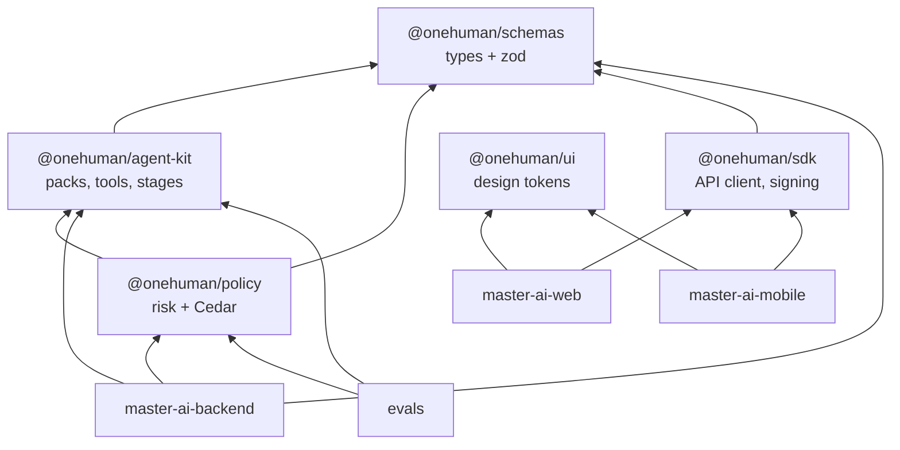

# packages

Code shared by the apps. Each package is built with tsup into `dist/`, and the apps import it from there. `pnpm dev` rebuilds them as you edit; otherwise run `pnpm build:packages`.

| Package | In one line |
|---|---|
| [schemas](schemas/README.md) | The single source of truth for data: zod schemas and types for packs, cases, the API and events |
| [agent-kit](agent-kit/README.md) | What agents and stages need: the tool catalog, pack resolution and checks, the case lifecycle (offline rules, AI prompts, merging), plain-words narration, prices, and the Gemini mapping |
| [policy](policy/README.md) | Decides every agent action and case gate: risk scoring plus Cedar rules compiled from the pack |
| [sdk](sdk/README.md) | The typed API client, the live update stream, approval signing, and the view helpers shared by web and mobile |
| [ui](ui/README.md) | The Glow design tokens (colours, type, spacing, gradients) for web (CSS variables) and mobile |

Every package except `schemas` has its own unit tests (`pnpm --filter @onehuman/<name> test`).
