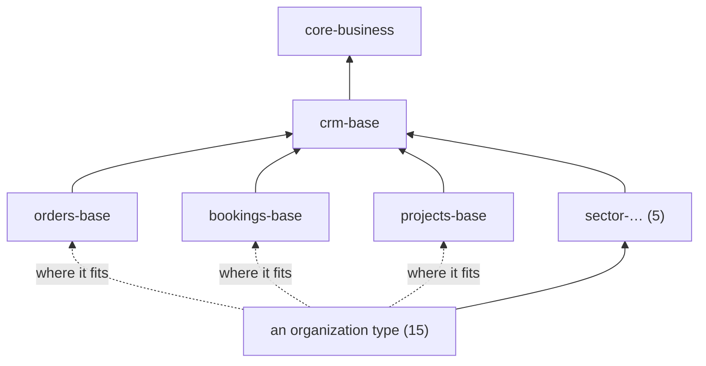

# packs

What ONEHUMAN OS knows about each kind of organization, written as YAML (`<id>/pack.yaml`). Adding a kind of organization means adding a pack and its test set; no code changes. To write one, follow the [pack guide](../docs/packs.md).

## How packs build on each other

Each pack `extends` others, and the most specific one wins.

- **`core-business`** is the root of every pack: the generic stage names, P1–P4 priorities, the owner role, the Case coordinator and the basic agents.
- **`crm-base`** adds customers and enquiries. **`orders-base`**, **`bookings-base`** and **`projects-base`** add the records and workflows of order-, booking- and project-based businesses.
- **Sector packs** (`sector-<id>`) hold what a whole sector shares: its default stages and roles, plus `other_org_types`, which lists the types an owner might write in their own words and the closest ready-made type for each.
- **Organization-type packs** name the 8 stages in their own words and add their kinds of request, roles, agents, records, workflows, rules, routines, KPIs and playbooks.

## The packs

| Sector | Organization types (pack id) |
|---|---|
| Energy & Heavy Industry (`sector-energy-heavy-industry`) | `power-plant` · `manufacturing-plant` (orders) · `construction` (projects) |
| Trade, Logistics & Tourism (`sector-trade-logistics-tourism`) | `logistics` (orders) · `wholesale-retail` (orders) · `travel-agency` (bookings) |
| Finance & Development (`sector-finance-development`) | `lender` · `accounting-firm` (projects) · `ngo` (projects) |
| Technology & Innovation (`sector-technology-innovation`) | `software-saas` (projects) · `it-services` (projects) · `digital-agency` (projects) |
| Essential Public & Service (`sector-public-services`) | `hospital` (bookings) · `education` (bookings) · `municipal` |

Each type has a test set in [`evals/suites/<id>.yaml`](../evals/README.md). The content was researched from Indian rules and practice; the questions that still need a sector expert are listed in [known gaps](../docs/known-gaps.md#questions-for-an-expert).

## What's in a pack

- **`lifecycle`**: the case label (Work order / JOB), the stage names, priorities, approver roles, urgent words, and categories with their keywords, required details and checks, not-eligible rules, approval and sign-off rules, and worked examples.
- **`entities`**: typed records, validated on every write.
- **`agents`**, **`tools`** (industry names over the generic primitives), **`workflows`**, and **`policies`** (compiled to Cedar).
- **`routines`**, **`kpis`** and **`playbooks`**.

## Checking a pack

- `pnpm --filter @onehuman/agent-kit test`: every pack here parses, resolves and validates.
- `pnpm evals`: every test set meets its floors.
- `pnpm pack:check --pack <draft> --suite <draft>`: checks a draft before it's copied here.

Installed workspaces keep a snapshot of their pack. Later additions to the base packs reach them only through the update banner, which adds and never replaces.
